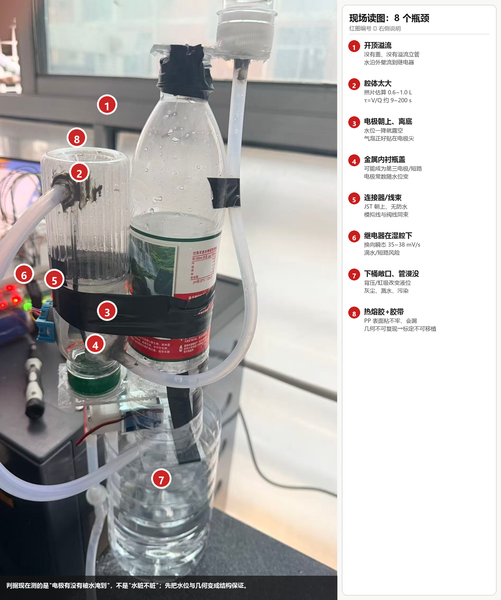
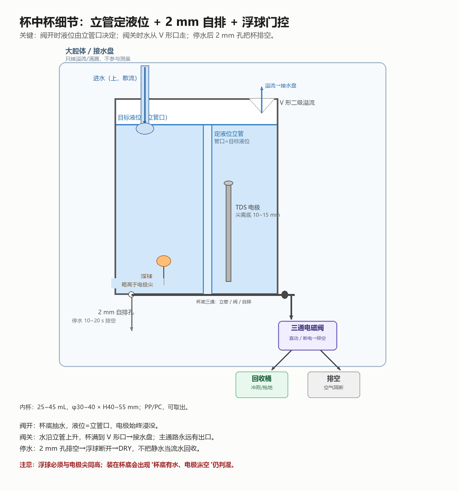
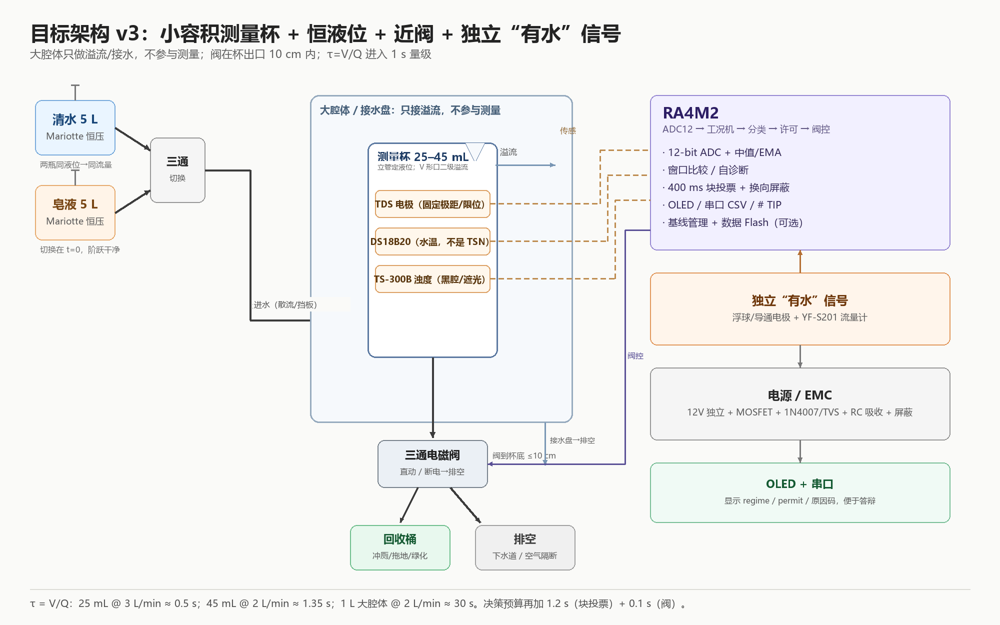

# 装置优化方案 v3 —— 结构 / 传感 / 流体 / 电气 / 实验方法

> **定位**：软件层已由 `软件层优化方案_v2_20261116.md` + `实施说明_v2_20261116.md` + `开机自检_v2.1_20261116.md` 覆盖（工况机、回收许可、基线、自检）。本文**不重复改状态机**，只补五层：**结构、传感、流体、电气、实验方法**。
>
> **时间前提**：今天 2026-11-16，按 11/20 评审倒排。所以下面按 **P0 今天 / P1 本周 / P2 赛后** 三档给；**P0 全部是"不改主结构、1 天内能完成"的**。
>
> **一句话结论**：当前最大的误差源不是算法，而是 **"电极有没有被水淹到"** 和 **"腔体太大、水太慢"**。先把这两件事变成**结构保证**，再谈阈值；否则调参只是在猜水位。

---

## 0. 结论速览（先看这张表）

| # | 优化 | 解决什么 | 档 | 成本 | 验收一句话 |
|---|---|---|---|---|---|
| 1 | **杯中杯**：大腔体只做溢流，内杯 25~45 mL 做测量 | 电极露空、水位决定判据、τ 几十秒 | **P0** | 0~20 元 / 2 h | 正常水流下电极始终浸没；停水 10~30 s 内 `DRY` |
| 2 | **金属内衬瓶盖换绝缘接头 + 固定极距/限位** | 金属盖成第三电极、电极常数随水位变 | **P0** | 10 元 / 1 h | 同一杯水插入 3 个深度，EC 差 <2%；10 次 CV <2% |
| 3 | **加一路独立"有水"信号**（浮球/导通电极） | 固件分不清"没水"和"水位低于电极" | **P0** | 5~10 元 / 1 h | 空腔 + 8~10 mL 低水位都不回收 |
| 4 | **继电器→MOSFET + RC 吸收 + TVS + 屏蔽/远离** | 换向瞬态 35~38 mV/s，和皂液信号同量级 | **P0** | 15~30 元 / 2 h | 换向时 ΔEC 跳动 <5 mV；不再 30 s 自激 |
| 5 | **加盖 + 溢流立管 + 接水盘 + 滴水弯** | 水沿外壁流到继电器、连接器 | **P0** | 20 元 / 1 h | 连续溢流 10 min，电子件不湿 |
| 6 | **Mariotte 恒压瓶 + 双水源阶跃台 + 流量计** | 重力瓶流量衰减，阶跃/延迟不可复现 | **P1** | 60 元 / 半天 | 同一阶跃 20 次，流量波动 <5%，延迟极差 <0.3 s |
| 7 | **黑腔/遮光 + 浊度温度补偿** | 透明 PP 杯 + 窗边强光；TS-300B 温漂 | **P1** | 10 元 / 2 h | 遮光前后 AO 差 <2%；20~30℃ 漂移 <3% |
| 8 | **运放缓冲 + 二阶低通 + 钳位 + 实测分压比** | ADC 源阻抗、1k/2.2k 与代码 1.5× 不一致 | **P1** | 10 元 / 半天 | 分压比误差 <0.5%；ADC 不超 3.0 V |
| 9 | **阶跃响应 + ROC/混淆矩阵** | "判得准"没有统计证据 | **P1** | 0 元 / 1 天 | 给出延迟分布、误回收率、回收率 |
| 10 | **3D 打印水平流通池 + CTSU/阻抗/UV** | 结构上限；酒精凝胶盲区 | **P2** | 100~200 元 / 3 天 | 按子项验收，不挤占评审 |

### 0.1 如果只有 2 小时：按这个顺序做

| # | 动作 | 时间 | 完成标志 |
|---|---|---|---|
| 1 | 量 V / Q / 电极高度（§1.2） | 10 min | 三个数写进实验记录 |
| 2 | 内杯 + 立管 + 2 mm 自排孔 + 浮球 | 60 min | 注水后杯内液位稳定；停水 10~30 s 排空 |
| 3 | 金属盖换绝缘接头 + 电极限位 | 20 min | 同一杯水插 3 个深度，读数差 <2% |
| 4 | MOSFET/RC/TVS + 屏蔽线 + 分开走线 | 30 min | 换向时 ΔEC 跳动 <5 mV |
| 5 | 加盖 + 接水盘 + 滴水弯 | 20 min | 连续溢流 10 min，电子件不湿 |
| 6 | 跑 §10 的 10 条验收 | 20 min | 至少 8 条通过；不通过的两条写进"已知问题" |

> 2 小时做不完 P1（恒压瓶/阶跃台/ROC）；但 P0 做完，装置就从"测水位"变成"测水质"，这是评审前最值钱的一步。

---

## 1. 现场读图：8 个瓶颈



> 照片是 2026-11-16 的样机。红圈编号与下表一一对应；"照片证据"只写看得见的东西，体积/流量等写"待量"。

| # | 照片证据 | 直接后果 | 对应优化 |
|---|---|---|---|
| 1 | **开顶**，没有盖、没有溢流立管；外壁全是水流痕 | 溢流沿外壁流到继电器/接头；灰尘、环境光直入 | P0-5 加盖 + 溢流立管 |
| 2 | 测量腔是**大号透明塑料杯**，照片估算 0.6~1.0 L | `τ=V/Q` 约 9~200 s；算法 0.2 s 的眼睛看几十秒前的水 | P0-1 杯中杯 |
| 3 | 电极**从底部朝上**，尖端离杯底还有一段 | 水位一降就露空；气泡上浮正好贴电极尖 | P0-1 + 6.2 固定几何 |
| 4 | 电极穿过**绿色瓶盖（可见金属内衬）** | 金属内衬接触水 → 第三电极/短路；电极常数随水位变 | P0-2 绝缘接头 |
| 5 | 蓝色 JST **朝上/朝外**，无防水；模拟线与阀线同束 | 水沿线进接头；阀线干扰 TDS 长线 | P0-4 + P0-5 |
| 6 | **继电器板紧贴湿腔下方/侧面**，红色 LED 可见 | 换向瞬态 35~38 mV/s；滴水/短路 | P0-4 + P0-5 |
| 7 | 下桶**敞口**，排水管可能浸在下桶水里 | 背压/虹吸改变腔体液位；灰尘、溅水 | P1-5 空气隔断 |
| 8 | 热熔胶封侧口、黑胶带捆扎；低表面能塑料 | 热熔胶在低表面能塑料上粘不牢、会漏；几何不可复现→标定不可移植 | P0-2 + P1-5 机械接头/支架 |

### 1.1 一句话

> **现在的判据测的是"电极有没有被水淹到"，不是"水脏不脏"**（诊断报告 §3.5 的结论）。软件 v2 用"浸没比值"把这句话挡了一层，但 **结构上仍然没有保证"有水 ⇒ 浸没"**，而且 **没有一路独立的"有没有水"信号**。软件只能在"猜水位"，结构必须先把答案给出来。

### 1.2 先量三个数（10 分钟）

在改任何东西之前，先量：

| 量 | 怎么量 | 用途 |
|---|---|---|
| **腔体实际容积 V** | 把腔体注满，倒进量杯；或注满后称重（1 g≈1 mL） | 算 τ；照片估算不算数 |
| **实际流量 Q** | 用 500 mL 量杯 + 秒表接 10 s；或转子流量计 | 算 τ；判断阀/管径是否匹配 |
| **电极尖端到杯底/溢流口的高度** | 钢尺 | 定内杯尺寸和电极限位 |

> 这三个数一出来，"τ 是多少、要缩到多少"就不用争论了。

---

## 2. P0：今天就能改（不改主结构，≤1 天）

### P0-1 杯中杯：让"测量"和"溢流"分开

> **这一条的关键不是"加个小杯"，而是"用一个立管把杯内液位钉死"**。只加小杯、杯底直接接阀，阀一开杯就抽空、电极照样露空——必须同时有**定液位的立管**和**停水后自排空的小孔**。

**做法**

1. 保留现有大腔体，但**降级为"接水盘/溢流罩"**：它只接内杯溢出的水和滴漏，底部接软管去排空，**不再作为测量体积**。
2. 在大腔体里放一个 **25~45 mL 的内杯**（PP 小杯、50 mL 离心管、或 3D 打印杯）：
   - 内径 30~40 mm，高 40~55 mm；
   - **杯内立一根 10~12 mm 的溢流立管**：下端接杯底三通，上端开口 = 目标液位；管口 **高于电极尖 10 mm、低于杯沿 10 mm**；
   - **杯底三通**：一路接立管，一路接 6 mm 软管到三通阀（阀在杯下 ≤10 cm）；立管与阀共用一个杯底出口；
   - **杯底开一个 2.0~2.5 mm 自排孔**（或三通上加一个 2 mm 限流孔）→ 接水盘：流水时只漏 3~6%，停水后 10~30 s 把杯排空；
   - **杯沿再锯一个 V 形口**（宽 8~10 mm、深 5~8 mm）作为**二级溢流**，只在立管堵住时启用；
   - **进水管从杯口上方进入**，出口在正常液面下 10 mm，端头加**散流帽/挡片**：形成**下向流**，避免"下进下出"直接短路、也避免射流把气泡打在电极上。如果坚持下进，杯内必须加一块**挡板**把进水与杯底出口隔开。
3. **传感器全部移进内杯**：
   - TDS 电极尖离杯底 **10~15 mm**，低于立管口 **10 mm**；
   - DS18B20 与 TDS 相距 15~20 mm，不碰电极；
   - 浊度探头优先放在**内杯主流区 + 黑色遮光套**；如果做侧壁小袋，小袋必须上下开孔形成穿流（见 P1-2），不能是死水袋；
   - **浮球开关装在"电极尖同一高度或高 2~3 mm"**（**不能低**；装在杯底会出现"浮球闭合、电极仍露空"），保证"浮球闭合 ⇒ 电极一定浸没"。
4. **三通阀接杯底三通，阀到杯底 ≤10 cm**；大腔体底部只接排空，不接阀。
5. 内杯做成**可取出**：杯口挂在大腔体盖子上，或用一个 PP 卡箍；方便清洗/换探头。

**为什么**

- `τ = V/Q`。25 mL @ 3 L/min ≈ **0.5 s**；45 mL @ 2 L/min ≈ **1.35 s**；1 L @ 2 L/min ≈ **30 s**。现在的大腔体把"阶跃"低通成了"斜坡"。
- **立管定液位**：杯底三通 + 立管 = 连通器。阀开时从杯底抽水，杯内液位 = 立管口；阀关时水在立管/杯内上升，杯满到 V 形口后进接水盘——**主通路永远有出口，阀卡死也不积水**。
- **2 mm 自排孔**：流水时进水量远大于漏水量（2~4 L/min vs 0.1~0.13 L/min），杯仍满到立管口；停水后 10~30 s 排空，浮球断开 → `DRY`，**不会把一杯静水当"正在洗手的清水"回收**。
- **下向流**：进水从上方散流、出水在杯底，水往下走，气泡往上浮、从杯口/立管口排出；电极不在"气泡上浮的终点"，也不在"进水射流的正前方"。
- 杯内体积小、流速相对高，**气泡被带走**；立管口/杯口都是气泡出口。
- 阀在内杯下游，**开关阀不改变杯内液位**（液位由立管定），所以不会出现"阀一开、液位掉、电极露空"的耦合。

> **不想改现有下进管路？** 保留杯底进水 + 散流帽 + 挡板即可；关键不是"上进还是下进"，而是**不要让进水直接短路到杯底出口**。图上标的是"进水（散流）"，两种走法都行。



**验收**

| 测试 | 通过标准 |
|---|---|
| 空腔上电 | `DRY`，阀不吸合，5 min 内无 `CLEAR` |
| 只倒 8~10 mL（液位低于电极尖/浮球） | 判 `DRY`；不回收 |
| 清水注满内杯 | 60 s 稳定 `CLEAR/RECOV`，无 30 s 周期 |
| 抽干/停水 | 10~30 s 内 `DRY`，阀释放（自排孔起作用） |
| 内杯溢流 | V 形口→大腔体；立管口只定液位、不外溢；不沿外壁流 |
| 阀关 10 s 再开 | 杯内液位不塌、电极不露空 |

**成本/工时**：0~20 元；2 h。**这是投入产出比最高的一条。**

---

### P0-2 绝缘接头 + 固定几何：把"电极常数"锁死

**做法**

1. **换掉金属内衬瓶盖**：用 **PVC/尼龙法兰**、**PP 板 + O 圈**、或 **Grove-TDS 原装探头自带的塑料螺纹座**；如果必须用瓶盖，把金属内衬**完整去掉/用环氧绝缘**，电极只与塑料接触。
2. **加限位套**：在 TDS 探头上套一段热缩管/3D 打印卡箍，保证每次插入深度一致；探头与杯底之间留 10~15 mm。
3. **固定极距**：
   - 如果是 Grove-TDS 原装双针探头：保留，间距由探头本体固定；重点是**别让金属盖成为第二电极**。
   - 如果是自制"单杆 + 金属盖"：改成 **两根 316L 不锈钢 M3 螺丝**，间距 **10.0 mm**，固定在 POM/PP 块里；电极面积约 3×3 mm²，插入深度固定 10 mm。
4. 电极引线用**屏蔽双绞线**，屏蔽层只在 MCU 端接地；接头朝下或加防水盒。

**为什么**

- 两电极电导池的读数是 `G = EC / K_cell`，`K_cell = d/A`（电导池常数）。**金属盖一接触水，A 就变成"盖的面积"，而且随水位变**；同一个探头在不同水位下 K 不同，读数当然漂。
- 金属内衬如果同时接触两根电极，就是**短路/分流**；如果只接触一根，就是**第三电极**，电势不定。
- 限位套解决"每次插多深"的问题；没有它，标定曲线只在当次装配有效。

**验收**

| 测试 | 通过标准 |
|---|---|
| 同一杯自来水，电极插入 3 个不同深度（都浸没） | EC 读数差 <2% |
| 同一杯水重复装拆 10 次 | CV <2% |
| 用 1413 µS/cm 标准液 | 记录实测偏差（目标 <10%，以实测为准；**不预设 ±5%**） |
| 电极与金属件绝缘 | 万用表 20 MΩ 档无穷大 |

**成本/工时**：10 元；1 h。

---

### P0-3 加一路独立"有水"信号：把"有没有水"和"脏不脏"分开

**做法（最省）**

1. 在内杯装一个 **常开浮球开关**（5~10 元，PP 材质），浮球位 **与 TDS 电极尖同一高度，或高 2~3 mm（不能低）**，保证"浮球闭合 ⇒ 电极一定浸没"；不要装在杯底——杯底有水、电极却可能露空。
2. 浮球串 **10 kΩ 上拉**到 3.3 V，接一个 GPIO（或 ADC）；固件把它映射到已有的 `VAL_FLOW` 位（`validity.h` 已留位）。
3. 门控规则（与 v2 的 `PERMIT` 一致）：
   - `浮球闭合` 是 `REGIME_MEASURE` 的必要条件；
   - `浮球断开` → 立即 `DRY`/`DRAIN`，不等 EC 比值；
   - `PERMIT = 浮球闭合 && level==L0 && regime==MEASURE`。
4. 备选（二选一即可）：
   - **两根不锈钢针 + 10 kΩ 上拉**：最便宜、最快，但会结垢/电解；适合当天验证。
   - **YF-S201 流量计**（P1）：同时给"在流"和累计水量，适合做回收率。
   - **CTSU 非接触**（P2）：杯壁外贴铜箔，不接触水、不结垢；但要标定，见 §6.1。

**为什么**

- 诊断报告 §3.5 的核心：**"没水"和"有水但水位低于电极"在 EC 上是同一个输入**。加一路独立的"有水"，这两个状态才分得开。
- 浮球信号与水质无关，**不受皂液、酒精、气泡影响**；它是"安全侧"的硬门控。
- 这一步做完，软件 v2 的"浸没比值"就从**唯一判据**降为**辅助判据**，鲁棒性上一个台阶。

**验收**

| 测试 | 通过标准 |
|---|---|
| 空腔 | 浮球断开；`DRY/DRAIN`；阀不吸合 |
| 8~10 mL 低水位（不淹电极） | 浮球断开；不回收 |
| 清水淹到浮球 | 浮球闭合；允许 `MEASURE` |
| 抽干 | 浮球断开后 ≤300 ms 转 `DRY` |
| 浮球线拔掉 | `FAULT`，阀排空（不静默） |

**成本/工时**：5~10 元；1 h。

---

### P0-4 电气：把 35~38 mV/s 的换向瞬态压下去

> 诊断报告实测：全段最大的 4 个速率都落在继电器吸合/释放之后，幅度 35~38 mV/s；**旧固件** `ec_rate_th_mv_s=40` 的门限只差一点（v2 已改 120）。**软件 400 ms 屏蔽是遮羞布，硬件上把瞬态压下去才是根本。**

**做法**

1. **继电器 → MOSFET 低边开关**：
   - IRLZ44N（或 AO3400，按阀电流选）；栅极 **100 Ω** 串联 + **10 kΩ** 下拉到 GND；
   - 阀线圈两端 **1N4007**（续流）+ **SMBJ18A/TVS**（吸收）；
   - 如果保留继电器：触点两端加 **RC 吸收**（100 Ω + 0.1 µF/100 V），线圈加 1N4007 + TVS。
2. **分开走线**：
   - 12 V 阀线、继电器线、TDS AOUT 线**分开 ≥10 cm**；必须交叉时**垂直交叉**；
   - TDS AOUT 用**屏蔽双绞线**，屏蔽层**只在 MCU 端**接地；
   - 12 V 线用双绞，减小环路面积。
3. **ADC 前调理**：
   - 1 kΩ + 100 nF RC（fc≈1.6 kHz）；再加 **BAT54S 钳位**到 3.3 V/GND；
   - 浊度分压后同样加 RC + 钳位。
4. **电源**：
   - 继电器/浊度的 5 V 与 MCU 的 5 V 分开（独立 LDO 或磁珠 + 100 µF）；
   - 12 V 入口 **1000 µF** 大电容 + **2 A 保险丝**；
   - 星形单点接地：阀/继电器大电流地不经过开发板（接线图已经是这个原则，保持）。
5. **软件配合**（已有）：换向 400 ms 屏蔽 + 速率门限 120 mV/s + 连续 2 tick；硬件改完后可把屏蔽缩到 200 ms 再试。

**为什么**

- 1 个 ADC 码 ≈0.89 mV（20℃）；35 mV/s 在 400 ms 窗口里约 18 个码，和"皂液数十 mV 的增量"同一量级。
- 继电器触点断弧是宽带噪声源；MOSFET 没有触点电弧，只剩线圈续流，1N4007+TVS 可以压得很低。
- 源阻抗：TDS 模块输出阻抗低，但长线 + 继电器耦合会把噪声带进来；RC + 屏蔽 + 钳位是标准三件套。

**验收**

| 测试 | 通过标准 |
|---|---|
| 示波器看 3.3 V 轨（阀换向瞬间） | 跌落 <50 mV，无振铃 |
| 串口 ΔEC（换向 ±400 ms） | 跳动 <5 mV |
| 空腔 5 min | 无 `CLEAR`，`# VALVE count` 不增长 |
| 连续换向 100 次 | 无复位、无丢帧、无自激 |

**成本/工时**：15~30 元；2 h。

---

### P0-5 防水/滴水：别让水流到继电器上

**做法**

1. **加盖**：大腔体加 PP/PC 盖（或保鲜盒盖），盖上开：
   - 一个 **10 mm 溢流立管（防底部排水堵塞的二级安全口）**：下端在大腔体目标液位（低于内杯 V 形口 5 mm），上端接软管去排空；立管同时做通气，避免虹吸；
   - 一个小通气孔（φ3 mm），防止盖内正压。
2. **接水盘**：大腔体下方放一个浅盘 + 吸水纸；盘里放两根不锈钢针做**漏液检测**（10 kΩ 上拉），触发时阀切排空 + 蜂鸣。
3. **电子件移位**：继电器/阀/接线盒移到**侧面或上方**，不要放在湿腔正下方；至少加一块 **PC 挡水板**。
4. **滴水弯**：所有线在进接头前做一个 **U 形低点**，让水滴在低点而不是接头里；蓝色 JST 朝下或加防水盒。
5. **接头**：热熔胶只做辅助；主密封用 **宝塔接头 + 卡箍** 或 **O 圈压紧**；塑料表面用**中性硅酮胶**（水族胶），不要用热熔胶承压。

**为什么**

- 照片里水正沿外壁流到继电器附近；一旦滴到 12 V/继电器，轻则误动作，重则短路。
- 溢流立管把"沿外壁乱流"变成"管内定向流"，同时给腔体一个稳定的液位边界。
- 漏液检测是答辩加分项：**"传感器失效/漏水怎么办"** 有实物回答。

**验收**

| 测试 | 通过标准 |
|---|---|
| 连续溢流 10 min | 电子件、接头、继电器不湿 |
| 漏液检测 | 触发后 ≤1 s 阀切排空 + 蜂鸣 |
| 拔掉溢流管 | 水从立管溢出到接水盘，不进入电子区 |
| 连续跑 30 min | 无滴漏、无积水 |

**成本/工时**：20 元；1 h。

---

## 3. P1：本周内（评审前）

### P1-1 Mariotte 恒压瓶 + 双水源阶跃台

**做法**

1. 两个 5 L 瓶（清水/皂液），各做一个 **Mariotte 恒压**：
   - 瓶盖密封，插一根 **通气管**，管口在目标液位（例如瓶口下 100 mm）；
   - 出水管在瓶底，接 ** pinch 阀**或三通；
   - 两瓶液位相同 → 两路流量相同；切换在 t=0，阶跃干净。
2. 用 **转子流量计（0~5 L/min）** 或 YF-S201 标定流量；目标 **2~4 L/min**（接近洗手龙头）。
3. 阶跃实验：清水流 10 s → 切皂液 10 s → 切回清水 10 s；50 ms 采样，记录 EC/NTU/温度。
4. 每次实验前测一次 Q；流量波动 >5% 的数据作废。

**为什么**

- 现在的重力瓶流量随液位下降而衰减；"延迟"里混了流量变化，无法和算法延迟分离。
- 恒压后，阶跃响应才是 **"算法 + 腔体"** 的真实值；这也是报告里"≤1.5 s"的主要证据。
- 两瓶同液位是"同流量"的保证；否则切换瞬间流量跳变，会把阶跃污染成"流量+浓度"双阶跃。

**验收**

| 测试 | 通过标准 |
|---|---|
| 同一阶跃重复 20 次 | 流量波动 <5%；延迟均值±σ，极差 <0.3 s |
| 清水→皂液 | 给出延迟、上升时间（10~90%）、超调 |
| 皂液→清水 | 给出回落时间；验证"先升后降"形状 |

**成本/工时**：60 元；半天。

---

### P1-2 黑腔/遮光 + 浊度温度补偿

**做法**

1. **遮光**：内杯外壁包 **黑色哑光 PP/铝箔**，只留 TS-300B 探头窗；探头周围加 **黑色海绵/橡胶遮光套**；大腔体盖也做黑色内衬。
2. **固定光路**：优先把 TS-300B 探头放在**内杯主流区**，用**黑色遮光套**包住探头本体、只露出光学窗；如果必须做侧壁小袋（φ25 mm、深 30 mm），小袋必须**上下各开一个 φ4 mm 孔形成穿流**，不能是死水袋——死水袋会让浊度比 EC 晚几秒，阶跃实验里会被误读成"浊度不响应"。
3. **温度补偿**：在 20/25/30℃ 三个温度点测清水 AO，拟合 `AO(T) = AO25 × (1 + k(T-25))`；固件加 `k` 修正。没有恒温槽就用热水/冷水兑，温度计读。
4. **环境光自检**：遮光前后各测一次清水 AO；如果差值 >2%，说明遮光没做好，先别用浊度判据。

**为什么**

- TS-300B 是**透射式**：LED 和光电晶体管之间是水；环境光从透明杯壁进入，直接叠加在光电晶体管上。照片里杯子就在窗边，是最坏情况。
- 透明塑料杯的**竖条纹**会折射/散射，等效光路长度随位置变；黑色哑光 + 固定光路把光路锁死。
- 浊度模块没有温度补偿；水温从 20℃ 到 30℃，AO 可能漂几个百分点，足以让 8%/25% 的门限失效。

**验收**

| 测试 | 通过标准 |
|---|---|
| 遮光前后清水 AO | 差 <2% |
| 20/25/30℃ 清水 AO | 漂移 <3%（补偿后 <1.5%） |
| 清水 vs 皂液（1 mL/L） | AO 均值±σ 可分（给出分离余量） |
| 气泡干扰 | 连续 60 s 的 AO 峰峰值 <2% |

**成本/工时**：10 元；2 h。

---

### P1-3 模拟前端：运放缓冲 + 二阶低通 + 钳位 + 实测分压比

**做法**

1. **TDS 通道**：Grove-TDS AOUT（0~2.3 V）→ **MCP6002 电压跟随** → **Sallen-Key 二阶低通 fc≈10 Hz** → 1 kΩ + 100 nF → BAT54S 钳位 → ADC。
2. **浊度通道**：AO（0~4.5 V）→ **1k/2k 分压（4.5 V→3.0 V，比现在的 1k/2.2k 更安全）** → **MCP6002 跟随** → 二阶低通 → 钳位 → ADC。**如果保留 1k/2.2k，代码里的 ×1.5 必须改成实测 ×1.4545**；两条路选一条，不要混。
3. **分压比实测**：用可调电源/分压器给 1.000 V 和 3.000 V，读 ADC 码，拟合 `AO = a×code + b`；把代码里的 `×1.5` 换成实测 `a`。
4. **电源**：模拟 5 V 用独立 LDO（或磁珠 + 100 µF）；3.3 V 数字/模拟分开走线，星形接地。

**为什么**

- 接线图里浊度分压是 **1k/2.2k**（节点 = AO×0.6875，反算 ×1.4545，4.5 V→3.09 V），而固件按 **×1.5** 换算（等价于 1k/2k，4.5 V→3.0 V）→ 两套不匹配，理论差 **3.1%**；电阻 5% 公差还会再差 2~3%。**建议硬件改 1k/2k（与代码一致、且 4.5 V 时正好 3.0 V），再做两点校准**；如果不动硬件，就把代码改成实测 ×1.4545。浊度门限是百分比，3% 的标定误差不能忽略。
- TS-300B 输出阻抗不低，ADC 采样保持会瞬间拉低节点；运放跟随把源阻抗降到毫欧级。
- 二阶低通把继电器/工频噪声压下去，和 P0-4 的硬件措施互补。
- 运放缓冲 + 低通 + 钳位是报告里"信号调理电路"的实打实素材，比只画一个分压电阻更像工程。

**验收**

| 测试 | 通过标准 |
|---|---|
| 分压比两点校准 | 误差 <0.5% |
| ADC 输入 | 任何工况不超 3.0 V |
| 换向时浊度读数 | 跳动 <1% |
| 50 Hz/100 Hz 干扰 | 低通后 <2 个码（有陷波更好） |

**成本/工时**：10 元；半天。

---

### P1-4 阶跃响应 + ROC/混淆矩阵：把"判得准"变成数字

**做法**

1. **阶跃响应**（用 P1-1 的台子）：
   - 20 次清水→皂液，20 次皂液→清水；
   - 记录：首次越限延迟、10~90% 上升时间、峰值、回落时间；
   - 同时记录阀实际动作时刻（`# VALVE` 行），算"判别→动作"延迟。
2. **ROC/混淆矩阵**：
   - 30 次清水 + 30 次皂液（0.5/1.0/2.0 mL/L 各 10 次）；
   - 特征：ΔEC、ΔNTU、变化率；先做一维 ΔEC 的 ROC，再做二维；
   - 选阈值：**误回收率 ≤1%** 优先（安全侧），再看回收率；
   - 报告：TP/FP/TN/FN、误回收率、回收率、AUC。
3. **阈值回填**：把选定的 d1/d2 写进 `app_main.c`，并在报告里写"由 ROC 定，不是拍脑袋"。

**为什么**

- 现在 d1/d2 是 `max(4σ,8)`/`max(8σ,20)` 的经验值，没有"误回收率"和"回收率"的统计。评委问"判得准不准"，ROC/混淆矩阵比"我觉得挺准"强十倍。
- **误回收和误排空的代价不对称**：误回收是把脏水送进回收箱，误排空只是少回收。阈值应该按"误回收率"定，而不是按"准确率"定。
- 阶跃响应是"≤1.5 s"的主要证据；没有它，时间预算只是纸面数字。

**验收**

| 产出 | 通过标准 |
|---|---|
| 延迟分布 | 20 次均值±σ；给出 P95 |
| 误回收率 | ≤1%（按选定阈值） |
| 回收率 | ≥80%（清水段） |
| ROC | 给出曲线和 AUC；阈值可复现 |

**成本/工时**：0 元；1 天。

---

### P1-5 阀/管路/空气隔断

**做法**

1. **阀靠近内杯**：阀到杯底出口 ≤10 cm（6 mm ID ≈ 3 mL，@2 L/min ≈ 0.09 s）。
2. **管径**：主路 8 mm ID；内杯出口 6 mm；不要用 4 mm 长管（压损大、易堵）。
3. **过滤**：阀前加 **Y 型过滤器/80 目滤网**，防毛发/颗粒卡阀；滤网可拆洗。
4. **空气隔断**：排水管末端**高于下桶水面 20 mm**，或下桶加盖 + 通气孔；**不要让管子浸在水里**。
5. **接头**：宝塔接头 + 卡箍；热熔胶只做辅助密封；PP 表面用中性硅酮胶。
6. **阀的选型确认**：按接线图是**直动式、断电→排空**，这是对的；现场再确认 **最低压差/流量**（直动阀一般 0 压差可开；先导式需要 ≥0.02 MPa，重力供压不够）。

**为什么**

- 阀离得远，等于给"脏水"多留了 `V_tube/Q` 的通行时间；10 cm 和 50 cm 在 0.5~2 L/min 下差 **0.3~1.7 s**。
- 排水管浸没会产生背压/虹吸，改变腔体液位；这正好是诊断报告 §3.4 "装置位置影响"的物理原因。
- 滤网是"毛发/纤维"这类传感器盲区的唯一解（6.2.2 盲区 4）。

**验收**

| 测试 | 通过标准 |
|---|---|
| 阀到杯底管路体积 | <5 mL |
| 排水管 | 不浸没；连续 30 min 无虹吸 |
| 滤网 | 30 min 无堵；拆洗后流量恢复 |
| 阀 | 0.2 m 水头下可靠换向；断电回排空 |

**成本/工时**：20 元；1 h。

---

## 4. P2：赛后/有余力（不要挤占评审）

| 优化 | 做法 | 价值 | 风险/前提 |
|---|---|---|---|
| **3D 打印水平流通池** | 20~30 mL，黑 PETG/PLA，O 圈，卡口传感器 cartridge；下进上出/水平流，顶部排气 | 固定几何、黑腔、可拆洗；τ<0.5 s @4 L/min | 3~5 天；需要打印/密封测试 |
| **CTSU 非接触液位** | 杯壁外贴 30×40 mm 铜箔 + guard ring；CTSU 自电容；标定 air/water/soap | 不接触水、不结垢；用足芯片外设 | 水导电、壁厚、手靠近；先静态实验 |
| **阻抗双通道 R+C** | 同一对电极 + 电阻 + GPIO，充放电计时得 C 分量 | 补酒精免洗凝胶盲区 | 与 TDS 模块共存/切换复杂 |
| **UV 荧光** | 365 nm LED + 光电二极管 + 暗腔 + 调制 | 检测荧光增白剂（部分洗手液） | 不是所有皂液都有；光学暗腔要求高 |
| **称重/流量计量** | 回收桶下 1 kg 称重 + HX711；或 YF-S201 累计 | 回收率、漏液、自动计量 | 机械/标定；评审前可不做 |
| **液压反卷积** | 把大腔体建模为 CSTR：`dC/dt=(Cin−C)/τ`，逆滤波/观测器估入口 | 大腔体也能"去拖尾" | 模型不准会放大噪声；不替代小池子 |
| **OLED 判据解释页** | 显示 `EC/g/dEC/dNTU/REG/PERMIT/原因码` | 评委一眼看懂"为什么" | 纯软件；半小时 |

---

## 5. 目标架构与量化



> 图是**系统级示意**：大腔体只做接水盘，测量在内杯；杯内立管/2 mm 自排/浮球的细节见 P0-1 的图。图中"进水（散流/挡板）"表示上进/下进都可，关键是加散流帽和挡板、避免短路。

### 5.1 为什么不是"更大的腔"

大腔体的好处是"稳"：抗流量脉动、抗气泡。但它的代价是 **把浓度阶跃低通成斜坡**：

```
τ = V/Q
V=1 L, Q=2 L/min → τ=30 s
V=25 mL, Q=2 L/min → τ=0.75 s
```

洗手全过程只有 10~30 s；**30 s 的腔体等于把整次洗手平均成一个数**，还谈什么"前段/中段/末段"。
正确做法不是"更大的腔"，而是 **"小测量杯 + 大接水盘"**：测量杯小、快；接水盘只负责溢流/滴漏，不参与测量。

### 5.2 τ 与决策预算（把"≤1.5 s"拆开）

**水力时间常数**（τ=V/Q，单位 s）：

| 体积 | 0.5 L/min | 1 L/min | 2 L/min | 3 L/min | 4 L/min |
|---|---|---|---|---|---|
| 15 mL | 1.8 | 0.9 | 0.45 | 0.30 | 0.23 |
| 25 mL | 3.0 | 1.5 | 0.75 | 0.50 | 0.38 |
| 45 mL | 5.4 | 2.7 | 1.35 | 0.90 | 0.68 |
| 1 L | 120 | 60 | 30 | 20 | 15 |

**决策预算**（软件 v2 的实测/配置值）：

| 环节 | 时间 | 说明 |
|---|---|---|
| 采样 | 50 ms | 20 Hz |
| 块投票 | 400 ms | 8 点 6 票 |
| 脏水→排空（速率路径） | ≈0.5 s | 2 tick + 块确认 |
| 清水→回收（L0 升级） | ≈1.2 s | 连续 3 块 |
| 阀动作 | 100 ms | 直动阀 |
| **合计（脏水路径）** | **≈0.6 s + τ + 管延迟** | 皂液阶跃 |
| **合计（清水路径）** | **≈1.3 s + τ + 管延迟** | 冲洗收尾 |

**结论（必须写进报告，别写死 1.5 s）**：

- 25 mL 内杯 + 3 L/min：脏水路径 ≈0.6+0.5+0.1=**1.2 s**；清水路径 ≈1.3+0.5+0.1=**1.9 s**。
- 15 mL 内杯 + 4 L/min：脏水路径 ≈0.6+0.23+0.1=**0.93 s**；清水路径 ≈1.3+0.23+0.1=**1.63 s**。
- 45 mL 内杯 + 2 L/min：脏水路径 ≈0.6+1.35+0.1=**2.05 s**；清水路径 ≈1.3+1.35+0.1=**2.75 s**。

> 所以"≤1.5 s"的准确表述是：**"在 3~4 L/min、25 mL 以内测量杯的条件下，脏水切换 ≤1.2 s，清水确认 ≤1.9 s"**。如果现场流量只有 0.5~1 L/min，任何算法都做不到 1.5 s——先把流量提上去，或在报告里写条件。

### 5.3 三种候选架构

| 方案 | 体积 | τ@3 L/min | 优点 | 缺点 | 适用 |
|---|---|---|---|---|---|
| **A 杯中杯（快改）** | 25~45 mL | 0.5~0.9 s | 1 天、低成本、保留现有外观 | 手工杯、清洗稍难 | **评审前** |
| **B 水平流通池（终版）** | 20~30 mL | 0.4~0.6 s | 固定几何、黑腔、可拆洗 | 3D 打印/加工 3~5 天 | 赛后 |
| **C 截留腔批式** | 100~200 mL | 2~4 s/批 | 判定时间长、抗噪 | 多阀、延时、残水 | 只在算法需要时 |

> **不建议**在评审前做 B/C；A 的收益已经能覆盖 80% 的问题。

---

## 6. 传感与电气细节

### 6.1 "有水"信号选型

| 方案 | 成本 | 响应 | 优点 | 缺点 | 建议 |
|---|---|---|---|---|---|
| **浮球开关（常开）** | 5~10 元 | 0.1~0.5 s | 便宜、二值、独立于水质 | 有运动件、可能卡 | **P0 首选** |
| **导通电极（不锈钢针）** | 2 元 | <10 ms | 最便宜、最快 | 结垢/电解、共享水路 | 当天验证 |
| **CTSU 非接触** | 0（PCB 铜箔） | 10~50 ms | 不结垢、芯片外设 | 需标定、壁厚、手靠近 | P2 实验 |
| **YF-S201 流量计** | 15~25 元 | 0.1~1 s | 流量+累计水量 | 需 >0.1 L/min、压损 | P1 推荐 |
| **称重** | 30~60 元 | 0.1 s | 回收率+漏液 | 机械/标定 | P2 |
| **光学液位（FS-IR02）** | 15 元 | <100 ms | 无运动件 | 需棱镜接触、气泡 | P1 备选 |
| **压力传感器** | — | — | — | 0.3 kPa vs 100 kPa 量级，不匹配 | **不做** |

> **推荐组合**：浮球（有水门控）+ YF-S201（事件/水量）。浮球回答"电极这里有没有水"，流量计回答"这次洗手用了多少水、回收了多少"。

### 6.2 TDS（电导率）

- **模块**：Grove-TDS（3.3 V，AOUT 0~2.3 V）是已核实不超 3.3 V 的选项，保留；不要用 DFR0300（0~3.4 V，量程 1~15 mS/cm 不适配自来水）。
- **几何**：见 P0-2；固定极距、固定插入深度、绝缘接头。
- **标定**：0.01 mol/L KCl = **1413 µS/cm @25℃**；或买一包标准液。记录 `EC_raw → µS/cm` 的斜率/截距。
- **温度补偿**：`EC25 = EC_T / (1 + α(T−25))`，α≈0.02/℃；用 DS18B20 的水温，不用 TSN（见 6.3）。
- **激励**：Grove-TDS 模块按厂商设计使用交流激励；如果自制电极，**不要用直流**（极化、漂移、电解）。
- **污染**：每次实验前用清水冲、软毛刷轻刷；每周用稀释柠檬酸/中性洗涤剂清洗；记录基线漂移。
- **气泡**：电极尖朝下/水平，或加挡片；气泡贴附会让 EC 读数**偏低**（判"更干净"），这是危险方向。

### 6.3 DS18B20 与 TSN（一条需要纠偏的文档结论）

> **纠偏**：`项目设想` 第 6.4 节写"RA4M2 有片上 TSN → 温度补偿不需要外接 DS18B20"。这句话**只在 MCU 与水温热耦合时成立**；本装置的 MCU 在空气中，**TSN 测的是芯片结温，不是水温**。所以：
>
> - **水温补偿必须用 DS18B20**；不要为了"省一个器件"把 DS18B20 去掉。
> - TSN 的正确用法：① 监测板温/环境温漂；② 与 DS18B20 做**合理性交叉检查**（两者差 >10℃ 且水温在变化 → 可能 DS18B20 脱落/断线）；③ 报告里写"用 TSN 做板温补偿、用 DS18B20 做水温补偿"，比"TSN 替代水温"更严谨。
>
> 这一条如果被评委追问"你的温度补偿用哪个传感器"，答错会掉分；现在改口径还来得及。

- **DS18B20 位置**：内杯里、TDS 电极下游 15~20 mm，不要贴壁/不要插在死水区；用薄壁不锈钢套管 + 导热硅脂。
- **响应**：防水探头在水里约 5~15 s 到 63%（以实测为准）；12 位转换 750 ms。洗手 10~30 s 内水温变化不大，慢一点可以接受；但**不要用它测快速温度阶跃**。
- **走线**：1-Wire 长线加 4.7 kΩ 上拉（接线图已有）；与阀线分开；必要时加 RC。

### 6.4 浊度（TS-300B）

- **原理**：透射式，LED 与光电晶体管之间是水；清水 AO 高，浊水 AO 低；**空气也高**（和清水同方向）→ 所以它分不出"空腔"和"清水"，必须有"有水"信号。
- **光路**：黑腔、固定光路（主流区遮光套，或带上下穿流孔的小袋）、探头窗与水流平行、避免气泡直冲；见 P1-2。
- **标定**：只用**相对浊度**，不要写 NTU；用高岭土/速溶奶粉做 0/5/10/20% 的相对梯度，给"相对浊度 vs AO"曲线。
- **温度**：20/25/30℃ 三点，线性补偿；没有恒温槽就用冷热水兑。
- **老化**：LED 老化会让 AO 缓慢漂移；每次上电用"干态 AO"做参考（v2.1 已有 `AO_DRY`），并记录漂移。
- **角色**：**只能"多排空"（否决回收），不能"少回收"**；空腔在它眼里是最干净的水，所以它拦不住"空腔回收"。

### 6.5 EMC / 信号调理（把 P0-4 展开）

| 措施 | 具体做法 | 作用 |
|---|---|---|
| 换向器件 | 继电器→MOSFET（IRLZ44N）+ 栅极 100 Ω/10 kΩ 下拉 | 消除触点电弧 |
| 线圈 | 1N4007 + SMBJ18A/TVS | 续流 + 钳位 |
| 触点（若保留继电器） | 100 Ω + 0.1 µF/100 V RC | 吸收断弧 |
| 布线 | 12 V 与模拟线 ≥10 cm；交叉垂直；12 V 双绞 | 降低容性/感性耦合 |
| 屏蔽 | TDS AOUT 屏蔽双绞，屏蔽单端接地 | 抑制共模 |
| ADC 前 | 1 kΩ + 100 nF + BAT54S 钳位 | 限带 + 保护 |
| 电源 | 12 V 1000 µF + 2 A 保险丝；5 V 模拟独立 LDO | 抑制跌落 |
| 接地 | 星形单点；阀/继电器地不经过开发板 | 避免地弹 |
| 软件 | 换向 400 ms 屏蔽（已有）；硬件改好后可缩到 200 ms | 双保险 |

**分压比**：接线图 1k/2.2k → 4.5 V 时节点 3.09 V（反算 ×1.4545）；代码 ×1.5 等价于 1k/2k（3.0 V）。**二选一：硬件改 1k/2k + 校准，或代码改 ×1.4545 + 校准**；不要用标称值直接换算。这是报告里"误差分析"的现成素材。

### 6.6 安全件（与 v2 红线一致）

1. **主通路常通**：阀只切回收/排空支路；大腔体溢流立管直通排空，阀卡死也不积水。
2. **防倒吸/空气隔断**：回收管路与自来水管不物理连通；排水管末端高于水面 20 mm；颜色标识（回收=绿，排空=灰）。
3. **溢流旁通**：大腔体溢流立管不经阀。
4. **电气**：12 V SELV、2 A 保险丝、漏液检测、看门狗、断电→排空（阀是弹簧复位）。
5. **不做饮用级**：只回用冲厕/拖地/绿化；不写"达到饮用水标准"。

---

## 7. 实验与数据：评审前至少要有这 6 张图表

| # | 图表 | 数据来源 | 通过标准 |
|---|---|---|---|
| 1 | **ΔEC vs 皂液浓度**（0/0.5/1.0/2.0 mL/L，均值±σ） | 静态配样 + 本机探头 | 单调上升；ΔEC/σ≥3 |
| 2 | **阶跃响应**（EC/NTU vs 时间；清水→皂液→清水） | P1-1 台子 + 50 ms 采样 | 给出延迟/上升时间/回落时间 |
| 3 | **ROC / 混淆矩阵** | 30 清水 + 30 皂液 | 误回收率 ≤1%，回收率 ≥80% |
| 4 | **浊度三态**（空气/清水/皂液 AO） | 本机 TS-300B | 给出均值±σ；说明"空气=清水"盲区 |
| 5 | **时间预算**（实测判别→阀动作） | `# VALVE` 时间戳 + 阶跃 | 与 §5.2 表一致 |
| 6 | **漂移/EMI**（100 次换向或 100 周期基线） | 长跑日志 | 基线漂移 <5%；无自激 |

### 7.1 测试矩阵

| 测试 | 操作 | 通过标准 |
|---|---|---|
| T1 空腔 | 排空上电 5 min | 无 `CLEAR`；阀 count 不增长 |
| T2 低水位 | 只倒 8~10 mL，不淹电极 | 不回收 |
| T3 浸没 | 清水淹到电极/浮球 | 60 s 稳定 `CLEAR/RECOV` |
| T4 流量 | 0.5/1/2/4 L/min 各 2 min | 给出 EC 波动 vs 流量 |
| T5 皂液阶跃 | 0.5/1.0/2.0 mL/L | 脏水路径 ≤1.2 s @3 L/min |
| T6 温度 | 20/25/30℃ | 温补后 EC 差 <2%；浊度漂移 <1.5% |
| T7 浊度梯度 | 0/5/10/20% 相对浊度 | 给出曲线；分离余量 |
| T8 长跑 | 100 周期/30 min | 无堵、无漏、无自激；基线漂移 <5% |
| T9 EMI | 连续换向 100 次 | 无复位；ΔEC 跳动 <5 mV |
| T10 断电 | 运行中拔电/上电 | 阀回排空；自检重跑；不误回收 |

### 7.2 FMEA（报告可直接用）

| 失效模式 | 影响 | 检测 | 缓解 |
|---|---|---|---|
| 电极露空/水位低 | 判"清水"回收脏水 | 浮球 + EC 比值 + 干态指纹 | 内杯恒液位；浮球门控 |
| 电极污染/结垢 | 基线漂移、灵敏度下降 | 基线漂移率、标准液复测 | 可拆洗；定期清洗；漂移告警 |
| 气泡贴附 | EC 偏低 → 判"更干净" | 稳定性位、浊度交叉 | 电极朝下/水平；杯口排气；稳定期 |
| 阀卡死/不换向 | 脏水进回收桶或无法回收 | 阀位反馈（可选）、流量/液位 | 断电→排空；溢流旁通；手动旁通 |
| 排水管浸没/虹吸 | 液位异常、背压 | 液位/流量异常 | 空气隔断；管口高于水面 |
| 传感器断线/开路 | 读数贴轨/伪值 | ADC 自诊断、量程检查 | `FAULT`→排空；不静默 |
| 继电器/阀瞬态 | 误判、自激 | 换向屏蔽、速率门限 | MOSFET/RC/TVS/屏蔽 |
| 漏水 | 短路/现场事故 | 漏液检测 | 接水盘、滴水弯、保险丝 |
| 断电 | 阀位不确定 | 上电自检 | 弹簧复位→排空；自检 |

### 7.3 地面真值（ground truth）

| 量 | 工具 | 用途 |
|---|---|---|
| EC | TDS 笔（~30 元）或台式电导率仪 | 验证在线 TDS 读数 |
| 体积 | 量杯/量筒 | 流量、回收率 |
| 温度 | 温度计/DS18B20 交叉 | 温补 |
| 浊度 | 高岭土梯度（相对） | 浊度曲线；**不写 NTU** |
| 时间 | 秒表/串口时间戳 | 延迟、阶跃 |

---

## 8. 答辩与演示（评审前 1 天）

### 8.1 演示脚本（核心 30 s + 排水观察 10~30 s）

| 时间 | 动作 | 观众看到 |
|---|---|---|
| 0~5 s | 清水流过 | OLED `CLEAR/L0`，阀切回收（绿桶） |
| 5~15 s | 加皂液/搓手 | `SOAP/L2`，阀切排空（灰桶）；串口 `dEC` 上升 |
| 15~25 s | 清水冲洗 | `dEC` 回落，`CLEAR/L0`，阀切回收 |
| 25~35 s | 关水 | 10~30 s 后浮球断开 → `DRY`，阀排空；OLED `待机` |

> 演示前把两个桶贴标签（回收=绿、排空=灰），把 OLED 的 `REG/PERMIT/原因` 页调出来；评委一眼能看懂"为什么切"。
>
> 演示前 **先上电自检/预标定 30 s**（v2.1 自检约 10 s 干态 + 等水 + 2 s 湿态 + 8 s 稳定）；上面的脚本从 `MEASURE` 开始，不要从冷机开始按秒表。

### 8.2 三句话（背下来）

1. **"我们不是定时器，是在线判别"**——同样的洗手动作，定时器做不到"先升后降"的形状。
2. **"我们不是绝对阈值，是基线相对增量"**——换水、换地点，上电自校准。
3. **"我们不是识别污染物，是发现偏离；拿不准就排空"**——这是安全侧，也是诚实。

### 8.3 三个必被问的问题

| 问题 | 回答（用数据） |
|---|---|
| "你凭什么判这杯水能回用？" | ΔEC vs 浓度曲线 + ROC/混淆矩阵 + 误回收率 ≤1% |
| "换个地方/换种水怎么办？" | 上电自校准 + 两种水源（自来水/矿泉水）实测基线；ΔEC 不是绝对阈值 |
| "传感器坏了/没水了怎么办？" | 浮球"有水"信号 + ADC 自诊断 + 干态指纹 + `FAULT→排空` + 断电→排空 |

### 8.4 已知局限（主动写出来）

- 酒精免洗凝胶：ΔEC 与浊度**双盲区** → 场景隔离 + 默认排空；不声称"识别所有污染"。
- 浊度：只给相对值，**不写 NTU**；空腔在浊度上=清水，不能单靠浊度。
- 不做微生物/COD/余氯检测；不声称"达到饮用水/GB/T 18920"。
- 跨次储水有生物膜风险 → 只做杂用水；演示当场排空，不存水。

---

## 9. BOM 与工时

### P0（今天，~50 元）

| 件 | 数量 | 估价 | 备注 |
|---|---|---|---|
| PP 内杯/50 mL 离心管 | 2 | 0~10 | 杯口锯 V 形溢流 |
| PVC/尼龙接头、O 圈 | 1 套 | 10 | 替换金属盖 |
| 浮球开关（常开） | 1 | 5~10 | 有水门控 |
| IRLZ44N / AO3400 | 2 | 4 | 阀驱动 |
| 1N4007 / SMBJ18A | 各 2 | 4 | 续流/钳位 |
| 100 Ω/0.1 µF/100 V | 1 套 | 2 | 触点吸收 |
| 屏蔽双绞线 | 1 m | 5 | TDS AOUT |
| BAT54S、电阻电容 | 1 套 | 5 | ADC 钳位/RC |
| PP 盖/接水盘/卡箍 | 1 套 | 10 | 防水 |

### P1（本周，~100 元）

| 件 | 估价 | 备注 |
|---|---|---|
| 转子流量计 0~5 L/min | 30 | 流量标定 |
| pinch 阀/三通 | 20 | 双水源切换 |
| MCP6002 + 阻容 | 10 | 运放缓冲/低通 |
| 黑色哑光贴/铝箔/遮光海绵 | 10 | 浊度遮光 |
| TDS 笔 | 30 | 地面真值 |

### P2（赛后，~150 元）

| 件 | 估价 | 备注 |
|---|---|---|
| 3D 打印流通池/光敏树脂 | 50 | 黑腔、卡口 |
| O 圈/接头 | 30 | 密封 |
| 称重传感器 + HX711 | 40 | 回收率 |
| UV LED/光电二极管 | 20 | 荧光实验 |
| 铜箔/屏蔽 | 10 | CTSU |

> 追加约 300 元（按现有器件已购计算），仍在 800 元预算内；**不要为了 P2 挤占 P0/P1 的时间**。

---

## 10. 验收清单（打印出来逐条打勾）

- [ ] 1. 空腔上电 5 min：无 `CLEAR`，阀 count 不增长。
- [ ] 2. 8~10 mL 低水位（不淹电极）：不回收。
- [ ] 3. 清水浸没：60 s 稳定 `CLEAR/RECOV`，无 30 s 周期。
- [ ] 4. 停水：10~30 s 后 `DRY`（自排孔），阀释放。
- [ ] 5. 皂液阶跃：3~4 L/min 下脏水路径 ≤1.2 s 切 `DRAIN`。
- [ ] 6. 换向：ΔEC 跳动 <5 mV；屏蔽窗内 `# STATE` 不变。
- [ ] 7. 拔探头/断线：`FAULT`、`DRAIN`、不静默。
- [ ] 8. 断电/上电：自检重跑；空腔不回收。
- [ ] 9. 连续 30 min：无漏、无滴到电子件、无堵、无虹吸。
- [ ] 10. 阶跃 20 次：延迟均值±σ、误回收率、回收率有数。

---

## 11. 不做清单（评审前）

| 不做 | 为什么 |
|---|---|
| ❌ 3D 打印整套新腔体 | 评审前 3~5 天风险太高；杯中杯 2 h 就能拿到 80% 收益 |
| ❌ 加泵/流量池/第二阀 | 增加泄漏点、调试量；现有重力 + 三通阀够演示 |
| ❌ 改 v2 状态机主体 | 软件已经验证过逻辑；只加"浮球门控"和阈值回填 |
| ❌ CTSU/阻抗/UV 主线化 | 都是 P2；没标定就上，答辩会被问穿 |
| ❌ 压力传感器做液位 | 0.3 kPa vs 100 kPa 量级，分辨率不够（已核实） |
| ❌ 用 TSN 替代 DS18B20 测水温 | TSN 是芯片结温，不是水温；见 6.3 |
| ❌ 写 NTU/GB/T 达标/微生物结论 | 没有标定/检测能力，写了就是编造 |
| ❌ 跨次储水/接触型回用 | 生物膜风险；只做冲厕/拖地/绿化 |

---

## 12. 与现有文档的 5 处纠偏/边界

| # | 现有说法 | 问题 | 本文口径 |
|---|---|---|---|
| 1 | "RA4M2 有 TSN → 温度补偿不需要 DS18B20" | TSN 测芯片结温，不是水温 | **保留 DS18B20**；TSN 做板温/合理性检查（6.3） |
| 2 | "判定延迟 ≤1.5 s（力争 0.8 s）" | 未说明流量/腔体体积；1 L 腔体 @2 L/min 光 τ 就 30 s | **写条件**：3~4 L/min、25 mL 内杯 → 脏水 ≤1.2 s、清水 ≤1.9 s（5.2） |
| 3 | 浊度分压"1k/2.2k"与代码 `×1.5` | 理论差 3.1%，电阻公差再 2~3% | **两点校准**实测分压比（6.5） |
| 4 | 自检"第一股水当清水基线" | 如果先放皂液，基线就是皂液 → 之后更干净的水被判"太干净"而排空（欠回收，安全侧） | 报告写明；有余力改成"前 10 s 的最小 EC"做基线（只降不升） |
| 5 | "上方有溢流口" | 照片里是开顶，水沿外壁流；溢流没有定向 | **加盖 + 溢流立管**，把溢流变成管内定向流（P0-5） |

> 这 5 条不是"文档错了"，而是**版本迭代中的边界条件**；答辩时主动说"我们在 v3 里把条件写清楚了"，比被问出来好。

---

*本文是 `装置优化方案 v3`，与 `软件层优化方案_v2` / `实施说明_v2` / `开机自检_v2.1` 并列；结构/传感/电气改动以本文为准，算法主体以 v2 为准。*
